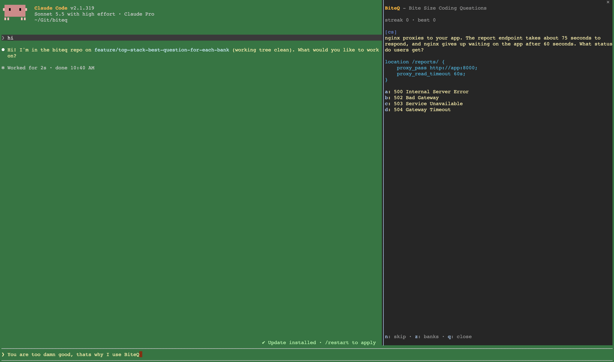

# BiteQ

Bite-size coding questions that appear while your AI agent is thinking, so you practice instead of reaching for your phone.



## Install

BiteQ is a plugin for [Claude Code](https://code.claude.com) (it uses function-hooks plugins, an early-access feature). You don't need to install anything else.

**In a Claude Code session (terminal or desktop app)**

```
/plugin marketplace add mingzew/biteq
/plugin install biteq@biteq
/reload-plugins
```

**Or from your terminal, as one line**

```bash
claude plugin marketplace add mingzew/biteq && claude plugin install biteq@biteq
```

Then start a new session. Check it worked with `claude plugin list` (it shows `biteq@biteq` enabled). Remove it with `claude plugin uninstall biteq@biteq`.

## First run

1. The pane opens with your session. In a terminal narrower than 144 columns, type `/biteq` to open it.
2. Prompt Claude. A question appears while Claude works.
3. Answer it, then move on.

| Where | How to answer | Other keys |
| --- | --- | --- |
| Terminal | Arrow keys and Enter, or `a`–`d` | `n` skip · `z` switch banks · `q` close · Enter for next after answering |
| Desktop app | Click an answer, then **Next** | **Switch Q banks** to change bank; the pane's own X closes it |

In the terminal the pane takes the keyboard each time Claude starts working (never over a half-typed prompt). Press Esc to hand it back to the prompt, or `ctrl+x tab` to give it to the pane again. On Windows the terminal shows `√`/`×` and `enter: next`, because console fonts have no `✓ ✗ ⏎`.

## Commands

| Command                | What it does                                                                                                                                                                              |
| ---------------------- | ----------------------------------------------------------------------------------------------------------------------------------------------------------------------------------------- |
| `/biteq [--lang bank]` | Open the pane; `--lang` picks the one bank to serve and is remembered (default `cs`). In the pane, `z` does the same                                                                      |
| `/biteq langs`         | List question banks, the selected ones first                                                                                                                                              |
| `/biteq check`         | Validate the question banks                                                                                                                                                               |
| `/biteq stats`         | Your stats: AI waits practised in while Claude worked and at any time, answers, streak, to review; per bank, `correct` (every attempt) and `one-shot` (right the first time, of the bank) |
| `/biteq doctor`        | Claude Code version, plugin path, store, status, debug log, questions, telemetry on or off                                                                                                                  |
| `/biteq pause on\|off` | Whether a new question is served once Claude is done: `on` (default) rests until Claude works again, `off` keeps serving. Remembered                                                      |
| `/biteq telemetry on\|off` | Turn usage reporting off or back on (see [Telemetry](#telemetry-and-privacy)). `/biteq doctor` shows which. Remembered, and `reset --all` keeps it |
| `/biteq debug [on\|off]` | Record each event to `~/.biteq/events.log` (`BITEQ_HOME` changes that directory). Remembered                                                                                            |
| `/biteq reset [--all]` | Reset the session status; `--all` also clears stats, config and the debug log                                                                                                             |

## How it works for you

- **Questions arrive while Claude works.** When Claude is done, you can finish the question on screen, but Next won't serve another: the pane says "Claude is done, go review" until Claude works again. **Serve next question** serves one anyway, and **Always serve** turns the pause off for good (`/biteq pause on` turns it back on). A new session opens the pane resting too, until you prompt Claude.
- **One bank at a time.** The default is `cs` (general CS questions, so anyone can start right away). Press `z` at any time to pick another bank; it's saved at once.
- **Missed questions come back.** Light spaced repetition, and once nothing is unseen they keep coming back until you get them right. When you finish a bank the pane congratulates you, shows how many you got right in one shot, and offers **Start over** or another bank.
- **Stats are shared by every session.** `/biteq stats` tracks the key number: how many AI waits (from one prompt to the next) you practised in while Claude worked.

## Telemetry and privacy

BiteQ counts how people use it, so we can tell whether it helps. It sends three kinds of report, each a small POST to our server:

- **Open:** the pane was placed in a Claude session.
- **Answer:** you answered a question.
- **Prompt:** you typed a prompt to Claude (a heartbeat, so we can compare people who use BiteQ with people who only use Claude). It is sent even if you never open the quiz.

Each report carries only four things: a random ID stored on your machine (not linked to your name, email or account), the Claude session ID, `terminal` or `desktop`, and the BiteQ version. **No prompt text, code, file names or answers are ever sent.** The quiz works the same either way.

To opt out of all three, run `/biteq telemetry off` (`/biteq telemetry on` turns it back on). The choice is remembered across sessions, and `/biteq reset --all` does not undo it. Nothing is sent, and no ID is created if you have none yet. If you already have an ID it stays on your machine, unused. BiteQ also sends nothing when Claude Code's own `CLAUDE_CODE_DISABLE_NONESSENTIAL_TRAFFIC` setting is on; that takes priority and never changes your saved choice. `/biteq doctor` shows `telemetry on`, `off (/biteq telemetry on to turn it back on)` or `off (Claude Code setting)`. With `/biteq debug` on, each skipped report is logged with its reason.

## Status

Alpha, version 0.1.0.

- Supported: the Claude CLI and the Claude desktop app's Code tab, on macOS and Windows.
- Other clients (for example the VS Code or Cursor extensions) get a basic fallback, not the full pane experience. Cursor's own chat agent doesn't run Claude Code plugins at all.
- Not built yet: notifications outside Claude Code, focusing the agent app when it's done, and Cursor native-agent support.

## Contributing

Want to add questions, a language, or change the code? See [CONTRIBUTING.md](CONTRIBUTING.md).
