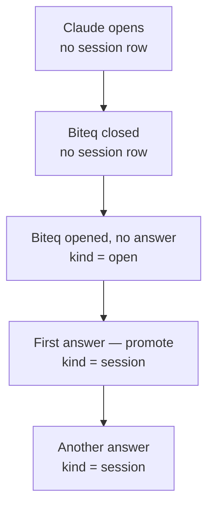

# Biteq telemetry

## Description

Biteq telemetry counts who uses the quiz and what they do with it. The plugin reports when the pane is placed and when an answer is recorded. The running totals update on each report, and each change is recorded so the counts can be shown by day and by harness (`terminal` or `desktop`).

## Metrics

The table is the all-time total for each metric. A change to a total is also recorded for the daily graphs.


| Name     | Description                                                                                                  | When it changes                                                          | CloudWatch metric (namespace `Biteq`, value `1`, unit `Count`) |
| -------- | ------------------------------------------------------------------------------------------------------------ | ------------------------------------------------------------------------ | -------------------------------------------------------------- |
| Users    | One machine: the UUID stored in that machine's plugin store.                                                 | First time this `userId` is stored                                       | `NewUsers`, dimension `Harness` of that first event            |
| Opens    | A Claude session whose biteq pane was placed. The count stays after an answer.                               | A session row is created with `kind=open`                                | `Opens`, dimension `Harness`                                   |
| Sessions | That same Claude session after the first recorded answer. Opened and never answered is opens minus sessions. | A session row becomes `kind=session`, or is created already as a session | `Sessions`, dimension `Harness` on that answer                 |
| Answers  | One recorded answer. Further answers in the same session add here and do not create another session.         | Every accepted answer event                                              | `Answers`, dimension `Harness` on that event                   |


`pluginVersion` is written to the log line. It is not stored and it is not a CloudWatch dimension.


## Open / Session  lifecycle

Promotion is the first recorded answer for a Claude session whose pane was already placed. The session row changes from `kind=open` to `kind=session`. The open total stays. The session total and the answer total each go up by one. A later answer in that same session adds an answer only.



One new machine, Claude CLI. The window is too narrow at startup, so the pane is placed only when biteq is opened. The desktop attributes stay at 0. The figures are the all-time totals after each action.


| After                     | users | opens | sessions | answers | Session row    | CloudWatch            |
| ------------------------- | ----- | ----- | -------- | ------- | -------------- | --------------------- |
| Claude opens              | 0     | 0     | 0        | 0       | none           |                       |
| Biteq closed              | 0     | 0     | 0        | 0       | none           |                       |
| Biteq opened, no answer   | 1     | 1     | 0        | 0       | `kind=open`    | `NewUsers`, `Opens`   |
| One question answered     | 1     | 1     | 1        | 1       | `kind=session` | `Sessions`, `Answers` |
| Another question answered | 1     | 1     | 1        | 2       | `kind=session` | `Answers`             |


Opened and never answered is opens minus sessions: 1 after the pane is placed, and 0 once the first answer promotes that row.

After the pane is placed, before any answer:

```
user#6b9f / seen
user#6b9f / session#0f3c    kind=open     harness=terminal
counters / totals           users=1  opensTerminal=1
```

The same row after the first answer. The open counter is still 1.

```
user#6b9f / seen
user#6b9f / session#0f3c    kind=session  harness=terminal
counters / totals           users=1  opensTerminal=1  sessionsTerminal=1  answersTerminal=1
```

The second answer leaves that row as it is and sets `answersTerminal=2`.

## Component Architecture

The plugin reports events. The AWS resources in `biteq-infra` store them and draw them.

- **Plugin** (`plugins/biteq`). Decides when a pane placement or an answer is worth reporting, keeps the user id in the plugin store, and POSTs the event. It does not keep the totals.
- **Function URL.** The public HTTPS address on the Lambda. The plugin calls `POST /v1/opens` and `POST /v1/answers`.
- **Lambda** (`biteq-telemetry`). Checks the body, updates DynamoDB, emits a CloudWatch metric when a total changes, and writes one log line per request.
- **DynamoDB** (`biteq-telemetry`). Holds the all-time numbers. One counter item stores the totals. A `seen` row and a session row record each machine and each Claude session, so a second open for the same session is not counted again.
- **CloudWatch metrics** (namespace `Biteq`). One datapoint per counted change, split by harness. The daily graphs read these.
- **CloudWatch dashboard** (`biteq-telemetry`). Shows the all-time totals and the daily lines.
- **CloudWatch Logs** (`/aws/lambda/biteq-telemetry`). One line per request, for tracing a user or session. The dashboard does not read these logs.


### DynamoDB

The all-time totals are one item in the `biteq-telemetry` table: `pk=counters`, `sk=totals`. These seven attributes live on that item only. Each is a number. Opens, sessions, and answers are split by harness, so the figure on the dashboard is the two attributes added together.


| Attribute          | What it counts                                 |
| ------------------ | ---------------------------------------------- |
| `users`            | Machines seen for the first time               |
| `opensTerminal`    | Panes placed on the Claude CLI                 |
| `opensDesktop`     | Panes placed on the Claude desktop Code tab    |
| `sessionsTerminal` | CLI sessions that have at least one answer     |
| `sessionsDesktop`  | Desktop sessions that have at least one answer |
| `answersTerminal`  | Recorded answers from the CLI                  |
| `answersDesktop`   | Recorded answers from the desktop app          |


An answer does not change the open attributes. The first answer adds one to that harness's session attribute. Opened and never answered is the open attributes minus the session attributes. A `seen` row and a session row are separate items in this same table. They do not carry these seven attributes.

## Biteq Plugin Component Changes

The plugin sends two events, `POST /v1/opens` and `POST /v1/answers`. The seven totals are not seven plugin calls. The harness on the event picks the terminal or desktop attribute, and the Lambda decides whether that event is a new user, a new open, a new session, or another answer.

### Payload

Both posts send the same four fields. An open uses `POST /v1/opens`. An answer uses `POST /v1/answers`.

```json
{
  "userId": "6b9f1a20-0c3e-4d5f-8a7b-9c0d1e2f3a4b",
  "sessionId": "0f3c1a2b-9d8e-4c7b-a6f5-1234567890ab",
  "harness": "terminal",
  "pluginVersion": "0.2.3"
}
```

`harness` *is* `terminal` *or* `desktop`*, from* `io.client()`*.* `pluginVersion` *is the* `version` *in* `${pluginRoot}/.claude-plugin/plugin.json`*. It is copied onto the log line and then dropped.*


| Field       | Where it comes from                                                                                                            | What happens to it                                                                                                                                |
| ----------- | ------------------------------------------------------------------------------------------------------------------------------ | ------------------------------------------------------------------------------------------------------------------------------------------------- |
| `userId`    | A UUID written to the plugin store under the key `userId` before the first POST. This is the machine the `users` total counts. | Reused after that, including when that POST was dropped. `/biteq reset --all` does not delete it. That command only deletes `stats` and `config`. |
| `sessionId` | `$.session.id()`, the transcript file name the Claude harness generates. The plugin does not generate one.                     | Reused for that Claude session. Stable across a hot reload, and new on a new window. The session row for this id is what stops a second open.     |


### User ID

The user id is a new concept that will allow our metrics to roughly determine the number of users. The user id is really a machine id since it is possible for engineers to share the same machine, however this case is unlikely and we will ignore it.

**How it is generated**

`crypto.randomUUID()`, once, when the store has no `userId` yet. That write happens before the first POST. Later reports send the same id, including when that POST was dropped.

**Where it is stored**

The plugin store, under the key `userId`. That store is this plugin's JSON file under `~/.claude/plugins/store/`, the same file `stats` and `config` already use, and every Claude session on the machine shares it. `/biteq reset --all` deletes `stats` and `config` only. It leaves `userId` in place.

### New atom `openReported`

Purpose: `openPane` runs on boot and again on every later wait, and a pane that is already up still returns `isPlaced: true`. `openReported` remembers that this Claude session already sent its one open, so those later calls do not send another.

It is a session boolean, default `false`, declared like the atoms already in `register.ts`:

```ts
const status = atom({ plugin: 'biteq', key: 'status' } as const, 'idle')
const since = atom({ plugin: 'biteq', key: 'since' } as const, 0)
const current = atom({ plugin: 'biteq', key: 'current' } as const, { question: null, picked: null })
const engaged = atom({ plugin: 'biteq', key: 'engaged' } as const, false)
const dismissed = atom({ plugin: 'biteq', key: 'dismissed' } as const, false)
const stats = atom({ plugin: 'biteq', key: 'stats' } as const, DEFAULT_STATS)
# New atom below
const openReported = atom({ plugin: 'biteq', key: 'openReported' } as const, false)
```

It is also added to `PluginState['biteq']` in `types/index.d.ts` and to both `key` switches inside `io()`. The POST is not awaited: `session.start` awaits `boot`, and a waited request would hold the session before the first prompt.

### Where each metric fires

`opensTerminal` **and** `opensDesktop`**.** `reportOpen` runs from `openPane` when `isPlaced` is true and `openReported` is false. `terminal` increments `opensTerminal`. `desktop` increments `opensDesktop`.

`users`**.** No plugin call of its own. The first POST that carries a new `userId`, which is the open unless that POST was dropped, causes the Lambda to create the `seen` row and add one to `users`. The harness on that first event is the `NewUsers` dimension.

`sessionsTerminal` **and** `sessionsDesktop`**.** The first recorded answer for that `$.session.id()`. The plugin sends `/v1/answers` with the harness of that answer. The Lambda sets the session row to `kind=session` and adds one to the session attribute for that harness. A later answer in the same Claude session does not add another session.

`answersTerminal` **and** `answersDesktop`**.** Every recorded answer. `pane.answer` sends `/v1/answers` after the stats save. The harness on that event picks the attribute. The second and third answers in one sitting each add one. They do not add a user, an open, or a session.

### Preventing duplicate opens

`boot` and every later wait both call `openPane`, and an already-placed pane still returns `isPlaced: true`. That produces two cases: a later open, after the first one has been recorded, and an overlapping open, before it has.

#### A later open

This starts once the first open has already been recorded: the next time Claude goes to thinking (`onStatus` calls `openPane` again), a `/biteq` that opens the pane, or a hot reload that runs `boot` again. The plugin stops it. The first `openPane` that places the pane sends the open, and a 2xx response sets `openReported` to `true`. A non-2xx response leaves it false, so a later `openPane` in that session sends again. Every later call after a 2xx sees the atom and does not POST. One session reports one open, on either harness.

#### An overlapping open

This starts when a second `openPane` begins before that response comes back. Boot is the usual first call, and the first prompt can reach `onStatus` while that POST is still in flight. The Lambda stops this one. Both calls still see `openReported` as `false` and both POST. They carry the same `sessionId`. The conditional put of `session#<sessionId>` accepts the first and rejects the second, and the open total moves once.

A repeated answer is a separate case, and the plugin stops it before a POST. `pane.answer` returns without saving when that question was already answered, so a second press does not send `/v1/answers`.

## Lambda Endpoints

One Lambda, one function URL, auth `NONE`, invoke mode `BUFFERED`, CORS off. The URL looks like `https://<id>.lambda-url.us-east-1.on.aws`. Paths are the function URL's raw path.

Bodies larger than 1024 bytes are `400`. The routes are `POST /v1/opens` and `POST /v1/answers`. Anything else is `404`. The all-time numbers are on the dashboard widget.

### `POST /v1/opens`

Sent once per placed pane per `$.session.id()`.

```json
{
  "userId": "6b9f1a20-0c3e-4d5f-8a7b-9c0d1e2f3a4b",
  "sessionId": "0f3c1a2b-9d8e-4c7b-a6f5-1234567890ab",
  "harness": "terminal",
  "pluginVersion": "0.2.3"
}
```

`harness` is `terminal` or `desktop`. `userId` is a UUID string. `sessionId` is a non-empty string up to 128 characters (it is a file name, not necessarily a UUID). `pluginVersion` is a non-empty string up to 32 characters.

### `POST /v1/answers`

Sent once per recorded answer, including the second and later answers in the same Claude session.

```json
{
  "userId": "6b9f1a20-0c3e-4d5f-8a7b-9c0d1e2f3a4b",
  "sessionId": "0f3c1a2b-9d8e-4c7b-a6f5-1234567890ab",
  "harness": "desktop",
  "pluginVersion": "0.2.3"
}
```

Same field rules.

### Responses


| Status | Body                                      | Meaning                                                                   |
| ------ | ----------------------------------------- | ------------------------------------------------------------------------- |
| 200    | `{ "ok": true, "duplicate": false }`      | Applied                                                                   |
| 200    | `{ "ok": true, "duplicate": true }`       | This session row already existed, so the open was not added               |
| 400    | `{ "ok": false, "error": "invalid" }`     | Missing field, wrong type, unknown harness, or body over 1024 bytes       |
| 404    | `{ "ok": false, "error": "not_found" }`   | Any other path or method                                                  |
| 500    | `{ "ok": false, "error": "unavailable" }` | The transaction did not commit. Nothing from that transaction was written |


The plugin treats every non-2xx, and every thrown fetch, as a drop. It only uses `ok` to decide whether to set `openReported`.

## Lambda

Code: `biteq-infra/biteq_infra/handler.py`. Runtime Python 3.12, arm64, 128 MB, timeout 5 seconds, reserved concurrency 5. The concurrency cap is the cost ceiling. There is no shared secret. A token compiled into the plugin would ship to every install.

The handler branches on the event:

- Function URL (`requestContext.http`) serves the two routes above.
- A CloudWatch custom-widget invoke (`widgetContext` or `describe`) returns the all-time HTML described under Dashboard. That invoke is IAM from CloudWatch, not the public URL.


### `POST /v1/opens` writes

`transact_write_items` is one DynamoDB transaction: every write in it commits together, or none of them do. `{"S": ...}` and `{"N": ...}` are DynamoDB's string and number types.

```python
# The function URL invokes the Lambda with the plugin's POST as `body`.
# {
#   "requestContext": {"http": {"method": "POST", "path": "/v1/opens"}},
#   "body": '{"userId":"6b9f...","sessionId":"session-2","harness":"terminal","pluginVersion":"0.2.3"}'
# }
body = json.loads(event["body"])
user_id = body["userId"]        # machine id, written in the plugin store before this POST
session_id = body["sessionId"]  # $.session.id(), the transcript file name
harness = body["harness"]       # "terminal" or "desktop"

# 1. Seen. Its own transaction, so "already seen" does not cancel the open below.
#    The item is only the two keys. A failed condition means this machine was already counted.
ddb.transact_write_items(TransactItems=[
    {"Put": {
        "TableName": "biteq-telemetry",
        "Item": {"pk": {"S": f"user#{user_id}"}, "sk": {"S": "seen"}},
        "ConditionExpression": "attribute_not_exists(pk)",
    }},
    {"Update": {
        "TableName": "biteq-telemetry",
        "Key": {"pk": {"S": "counters"}, "sk": {"S": "totals"}},
        # users is a DynamoDB reserved word. The alias is only for this expression.
        # The attribute stored on the item is still users.
        "UpdateExpression": "ADD #users :one",
        "ExpressionAttributeNames": {"#users": "users"},
        "ExpressionAttributeValues": {":one": {"N": "1"}},
    }},
])
# committed -> emit NewUsers with this harness
# condition failed -> continue

# 2. Open. Same pk as seen, different sk, so the seen row does not block this put.
#    opensTerminal when harness is "terminal", otherwise opensDesktop.
opens = "opensTerminal" if harness == "terminal" else "opensDesktop"
ddb.transact_write_items(TransactItems=[
    {"Put": {
        "TableName": "biteq-telemetry",
        "Item": {
            "pk": {"S": f"user#{user_id}"},
            "sk": {"S": f"session#{session_id}"},
            "kind": {"S": "open"},
            "harness": {"S": harness},
        },
        "ConditionExpression": "attribute_not_exists(pk)",
    }},
    {"Update": {
        "TableName": "biteq-telemetry",
        "Key": {"pk": {"S": "counters"}, "sk": {"S": "totals"}},
        "UpdateExpression": f"ADD {opens} :one",
        "ExpressionAttributeValues": {":one": {"N": "1"}},
    }},
])
# committed -> emit Opens
# condition failed -> this session already has a row; { "ok": true, "duplicate": true }
```


### `POST /v1/answers` writes

The event is the same shape, with `"path": "/v1/answers"`. The body fields are the same four. Run the seen transaction above first: an answer can be the first event for a machine when the open POST was dropped. Then try the three transactions below in order. The first whose condition matches commits. `Sessions` and `Answers` both use `harness` on this answer.

```python
suffix = "Terminal" if harness == "terminal" else "Desktop"

# Promote. The session row is still an open: set kind to session and count both.
ddb.transact_write_items(TransactItems=[
    {"Update": {
        "TableName": "biteq-telemetry",
        "Key": {"pk": {"S": f"user#{user_id}"}, "sk": {"S": f"session#{session_id}"}},
        "UpdateExpression": "SET kind = :session",
        "ConditionExpression": "kind = :open",
        "ExpressionAttributeValues": {":session": {"S": "session"}, ":open": {"S": "open"}},
    }},
    {"Update": {
        "TableName": "biteq-telemetry",
        "Key": {"pk": {"S": "counters"}, "sk": {"S": "totals"}},
        "UpdateExpression": f"ADD sessions{suffix} :one, answers{suffix} :one",
        "ExpressionAttributeValues": {":one": {"N": "1"}},
    }},
])
# committed -> emit Sessions and Answers. The open counter stays as it is.

# Already a session. Confirm kind and count the answer only. No Sessions metric.
ddb.transact_write_items(TransactItems=[
    {"Update": {
        "TableName": "biteq-telemetry",
        "Key": {"pk": {"S": f"user#{user_id}"}, "sk": {"S": f"session#{session_id}"}},
        "UpdateExpression": "SET kind = :session",
        "ConditionExpression": "kind = :session",
        "ExpressionAttributeValues": {":session": {"S": "session"}},
    }},
    {"Update": {
        "TableName": "biteq-telemetry",
        "Key": {"pk": {"S": "counters"}, "sk": {"S": "totals"}},
        "UpdateExpression": f"ADD answers{suffix} :one",
        "ExpressionAttributeValues": {":one": {"N": "1"}},
    }},
])

# No row: /clear, or the open never landed. Create the session from this answer.
ddb.transact_write_items(TransactItems=[
    {"Put": {
        "TableName": "biteq-telemetry",
        "Item": {
            "pk": {"S": f"user#{user_id}"},
            "sk": {"S": f"session#{session_id}"},
            "kind": {"S": "session"},
            "harness": {"S": harness},
        },
        "ConditionExpression": "attribute_not_exists(pk)",
    }},
    {"Update": {
        "TableName": "biteq-telemetry",
        "Key": {"pk": {"S": "counters"}, "sk": {"S": "totals"}},
        "UpdateExpression": f"ADD sessions{suffix} :one, answers{suffix} :one",
        "ExpressionAttributeValues": {":one": {"N": "1"}},
    }},
])
# committed -> emit Sessions and Answers
# If this put loses because the row now exists, try promote, then already-a-session, once more.
```


### Counter item

`pk=counters`, `sk=totals`. Attributes, all numbers: `users`, `opensTerminal`, `opensDesktop`, `sessionsTerminal`, `sessionsDesktop`, `answersTerminal`, `answersDesktop`. Updates are `ADD`, which creates the attribute. No scan. The dashboard widget is one `GetItem` of this item. Missing attributes read as `0`.

## DynamoDB table

Created in the stack as `biteq-telemetry`.

- Partition key `pk` (string), sort key `sk` (string).
- Billing on demand.
- Point-in-time recovery off.
- Removal policy `RETAIN`. A stack update must not delete the table.


| pk              | sk                    | Attributes                              |
| --------------- | --------------------- | --------------------------------------- |
| `counters`      | `totals`              | the seven numbers above                 |
| `user#<userId>` | `seen`                | the two keys                            |
| `user#<userId>` | `session#<sessionId>` | `kind` (`open` or `session`), `harness` |


## CloudWatch logs

The function's log group is `/aws/lambda/biteq-telemetry`, retention 30 days. One JSON line per request that passed validation, including duplicate results:

```json
{"type":"open","userId":"...","sessionId":"...","harness":"terminal","pluginVersion":"0.2.3","result":"created"}
```

`result` is `created` for a new open, `promoted` when an answer creates or promotes the session, `answered` for a later answer, or `duplicate`. Invalid requests and a `500` log the status only, not the body. These lines are for tracing one id through time. The dashboard does not query them.

## Dashboard

CloudWatch dashboard `biteq-telemetry`, region `us-east-1`, same account as the Lambda. One page:

1. **All-time**, a custom widget that invokes this Lambda. On `describe` the function returns `{ "markdown": "biteq all-time" }`. On `widgetContext` it `GetItem`s the counter row and returns the HTML string for four figures (users, opens, sessions, answers) and under them the terminal and desktop split. A JSON object would be shown as text. This widget is not the public URL.
2. **Last 12 weeks, one day wide.** Four line widgets, statistic `Sum`, metrics `NewUsers`, `Opens`, `Sessions`, `Answers`. Each widget has two lines, `Harness=terminal` and `Harness=desktop`.

Metrics are standard resolution (60 seconds). The Lambda calls `PutMetricData` only after the matching transaction commits. A duplicate request emits nothing.

Open the dashboard in the CloudWatch console.

## Infrastructure

`biteq-infra` is its own CDK app. The stack is `BiteqTelemetryStack` in `biteq_infra/biteq_infra_stack.py`. It deploys to account `659775408083`, region `us-east-1`, the heyyproperty production account, the same account as `webapp-infra`'s prod deploy. The Lambda has no VPC, so the function URL and DynamoDB are reachable on their own. `WebappInfraStack` stays unchanged. A `cdk deploy` from `biteq-infra` updates only this stack.

The plugin carries this one URL. Account `975050043441` is not a target.

The function's role can `dynamodb:GetItem`, `PutItem`, `UpdateItem`, and `TransactWriteItems` on this table only, and `cloudwatch:PutMetricData` with `cloudwatch:namespace` = `Biteq`. Log writes come from the Lambda basic execution role. The construct id `BiteqTelemetry` stays fixed; renaming it issues a new URL.

Stack outputs:

- `BiteqTelemetryUrl`, the function URL, no trailing slash. The plugin appends `/v1/opens` and `/v1/answers`.
- `BiteqTelemetryDashboard`, the console link to dashboard `biteq-telemetry`.


## Tasks


### Plugin

`telemetry.ts` must not touch `$`. `httpPost` is `$.http.fetch` with method `POST`, a JSON content type, and the body string, mapped to `{ ok: response.ok }`. No `auth` field, so `CLAUDE_CODE_DISABLE_NONESSENTIAL_TRAFFIC` does not refuse it. An organization web-fetch policy still can, and that refusal is a dropped event.

A report is skipped when `io.pluginRoot` does not contain `.claude/plugins/cache/` (`claude --plugin-dir` and `claude plugin test` both load the checkout), when `io.client()` is not `terminal` or `desktop`, or when the POST throws or returns a non-2xx.

- `types/index.d.ts`. Add `openReported: boolean` to `PluginState['biteq']`.
- `register.ts`. Declare the `openReported` atom, default `false`, and add a case to both `io()` switches. Implement `sessionId` and `httpPost`. From `openPane`, after `isPlaced` is true, call `reportOpen` without awaiting it.
- `io.ts`. Add `sessionId(): Promise<string>` and `httpPost(url, body): Promise<{ ok: boolean }>` to `Io`.
- `store.ts`. Add the store key `userId`. `/biteq reset --all` keeps deleting `stats` and `config` only.
- `hooks/biteq/telemetry.ts`. New. Builds the two payloads, applies the skip rules above, and reads `version` from `${pluginRoot}/.claude-plugin/plugin.json`. When `userId` is missing, write it to the store before the POST. Set `openReported` only when the response is 2xx. The endpoint constant is the `BiteqTelemetryUrl` stack output.
- `pane.tsx`. After `answer` has saved stats for a new answer, call the answer report. A repeat press already returns before that save, so it does not report.


### Lambda

`biteq-infra/biteq_infra/handler.py`. Python 3.12, arm64, 128 MB, timeout 5 seconds, reserved concurrency 5.

- Function URL, auth `NONE`, invoke mode `BUFFERED`, CORS off. `POST /v1/opens` and `POST /v1/answers` follow the write steps above. Any other path or method is `404`. A body over 1024 bytes, or a body that fails the field rules, is `400`. A transaction that fails for a reason other than its condition is `500`.
- On a CloudWatch custom-widget invoke, `describe` returns `{ "markdown": "biteq all-time" }`, and `widgetContext` returns the HTML string for the four all-time figures plus the terminal and desktop split. That invoke is IAM, not the public URL. It `GetItem`s `pk=counters`, `sk=totals`. Missing attributes read as `0`.
- Emit `NewUsers`, `Opens`, `Sessions`, and `Answers` in namespace `Biteq` only after the matching transaction commits. A duplicate emits nothing. Standard resolution.
- Write one JSON log line per request that passed validation. `result` is `created`, `promoted`, `answered`, or `duplicate`. An invalid request and a `500` log the status only.


### DynamoDB

- Table `biteq-telemetry`. Partition key `pk` (string), sort key `sk` (string), on-demand billing, point-in-time recovery off, removal policy `RETAIN`.


### CloudWatch Logs

- Log group `/aws/lambda/biteq-telemetry`, retention 30 days.


### Dashboard

- Dashboard `biteq-telemetry` in `us-east-1`.
- An all-time custom widget that invokes this Lambda.
- Four line widgets for the last 12 weeks, one day wide, statistic `Sum`: `NewUsers`, `Opens`, `Sessions`, `Answers`. Each has two lines, `Harness=terminal` and `Harness=desktop`.


### Infrastructure

`biteq-infra` is a separate CDK app from `webapp-infra`. Stack `BiteqTelemetryStack` in `biteq_infra/biteq_infra_stack.py`.

- Deploy only to account `659775408083`, region `us-east-1`. Leave `WebappInfraStack` unchanged.
- Leave the function with no VPC. Leave `WebappVPC` in the heyyproperty stack.
- The function role can `dynamodb:GetItem`, `PutItem`, `UpdateItem`, and `TransactWriteItems` on this table only, and `cloudwatch:PutMetricData` with `cloudwatch:namespace` = `Biteq`. Log writes come from the Lambda basic execution role.
- Outputs: `BiteqTelemetryUrl` (no trailing slash) and `BiteqTelemetryDashboard` (the console link). The function construct id is `BiteqTelemetry`.


## Decisions already made

- An **open** is one Claude session whose biteq pane was placed (`$.ui.open` returned `isPlaced: true`). The count stays after an answer.
- A **session** is that same Claude session after the first recorded answer. The first answer does not reduce the open count. Opened and never answered is opens minus sessions.
- A **user** is one plugin store: one Claude config on one machine. The id is a UUID created once and kept under the store key `userId`.
- The session id is `$.session.id()` (the transcript file name). It is stable across a hot reload. The plugin does not mint one.
- The harness is `terminal` (Claude CLI) or `desktop` (Claude desktop Code tab), the same two values `client.ts` already uses.
- `--plugin-dir` loads are not counted.
- There is no download metric and no shared-secret auth. The function URL is public.
- `/clear` is ignored. It replaces `$.session.id()` and does not fire `session.start`. An answer that arrives for an id the Lambda has never opened is stored as a session directly.
- A failed POST is dropped. The quiz never waits on it and never resends that body. `userId` is already in the store, so the next report for that machine uses the same id.
- There is no event id. A second open for the same session id is rejected by the session row. A repeated answer is stopped in `pane.answer` before a POST.
- The all-time figures are the dashboard widget. There is no public totals URL.
- A session is counted with the harness on the answer. One Claude session stays on one surface.
- Telemetry runs from `biteq-infra`, stack `BiteqTelemetryStack`, in the heyyproperty production account `659775408083` (`us-east-1`). The Lambda is not in a VPC. `WebappInfraStack` stays as it is.

